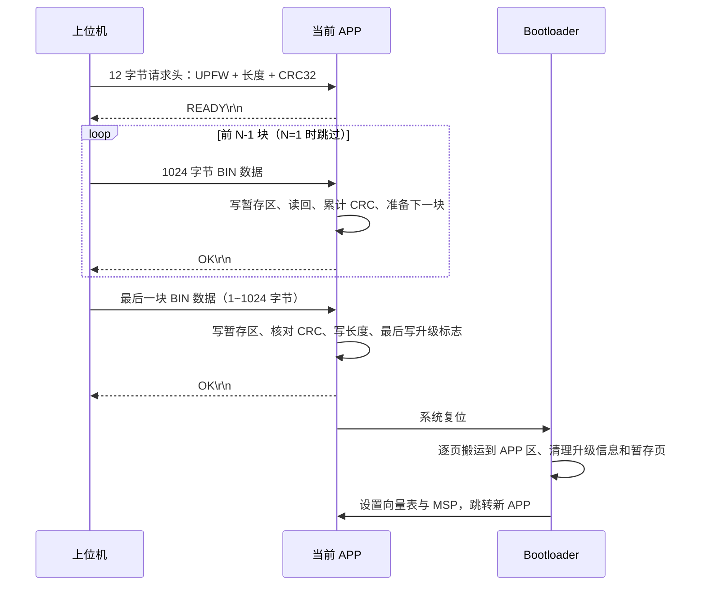

# AT32 IAP 串口固件升级

基于 **AT32F403AVGT7** 的在线升级工程，包含 Bootloader、FreeRTOS APP 和 Windows 串口上位机。

APP 通过 USART1 接收新固件，将其写入 Flash 暂存区；完整接收并通过 CRC32 校验后，写入升级信息并复位。Bootloader 在启动时检查升级标志，将暂存固件搬运到 APP 执行区，再跳转到 APP。

用户在上位机点击一次“开始下发”即可完成发送；请求头、分块发送和等待回应均由上位机自动处理。

## 1. 工程目录

```text
at32_iap/
├── README.md
├── at32_iap_bootloader/                  # 启动、固件搬运、跳转 APP
│   └── project/
│       ├── MDK_V5/at32_iap_bootloader.uvprojx
│       ├── src/main.c
│       └── bsp/                         # Bootloader 使用的 Flash BSP
├── at32_iap_app/                         # 业务 APP、串口接收、升级任务
│   ├── project/MDK_V5/at32_iap_app.uvprojx
│   └── ace_robot_kit/
│       ├── APP/app_task/                # 应用任务及固件升级任务
│       ├── BSP/                         # Flash、USART 等板级接口
│       └── Component/crc_check/         # CRC 校验组件
└── at32在线升级上位机/
    ├── app.py                           # 上位机界面与串口工作线程
    ├── protocol.py                      # UPFW 协议与 CRC 计算
    ├── dist/AT32_Firmware_Updater.exe    # 可独立运行的 Windows 上位机
    └── 升级固件/                        # LED 演示固件
```

主要逻辑入口：

| 功能 | 文件 |
| --- | --- |
| Bootloader 升级判断、搬运和跳转 | [main.c](at32_iap_bootloader/project/src/main.c) |
| APP 接收固件、CRC 校验及提交升级信息 | [app_update_fw_task.c](at32_iap_app/ace_robot_kit/APP/app_task/app_update_fw_task.c) |
| 创建应用任务、启动调度器 | [app_task.c](at32_iap_app/ace_robot_kit/APP/app_task/app_task.c) |
| USART1 接收中断入口 | [at32f403a_407_int.c](at32_iap_app/project/src/at32f403a_407_int.c) |
| CRC32 算法 | [crc_check.c](at32_iap_app/ace_robot_kit/Component/crc_check/crc_check.c) |
| 上位机发送协议 | [protocol.py](at32在线升级上位机/protocol.py) |

## 2. Flash 分区

Flash 地址范围为 `0x08000000 ~ 0x080FFFFF`，总容量 **1 MB**。擦除页大小为 `0x800`，即 **2 KB**；BSP 按 **4 字节**编程。

本文中 `1 KB = 1024 字节`；分区结束地址均包含在该分区内。

| 区域 | 起始地址 | 结束地址（含） | 大小 | 用途 |
| --- | --- | --- | --- | --- |
| Bootloader 代码区 | `0x08000000` | `0x080057FF` | `0x5800`，22 KB | 上电启动、固件搬运、跳转 APP |
| 升级信息页 | `0x08005800` | `0x08005FFF` | `0x800`，2 KB | 保存升级标志及固件长度 |
| APP 执行区 | `0x08006000` | `0x0805FFFF` | `0x5A000`，360 KB | APP 实际运行的位置 |
| OTA 暂存区及剩余空间 | `0x08060000` | `0x080FFFFF` | `0xA0000`，640 KB | 接收新固件，剩余部分暂未使用 |

**当前固件最大为 `0x5A000 = 368640 字节 = 360 KB`。** 上位机和 APP 均检查这个上限，超过后不允许升级。限制来自 APP 执行区的大小：暂存区即使还能存放数据，最终搬运后的固件也必须能放进 APP 执行区。

按照这个上限，暂存固件最多使用 `0x08060000 ~ 0x080B9FFF`；其后的 `0x080BA000 ~ 0x080FFFFF` 为 280 KB 剩余空间。当前接收及搬运逻辑只擦除本次固件用到的暂存页。

### 2.1 升级信息页

| 地址 | 类型 | 内容 |
| --- | --- | --- |
| `0x08005800` | `uint32_t` | 升级标志；等于 `0xAA5555AA` 时，Bootloader 执行搬运 |
| `0x08005810` | `uint32_t` | BIN 原始长度，单位为字节 |
| 其余位置 | — | 当前未使用 |

APP 提交升级信息的顺序固定为：

1. 擦除整个升级信息页。
2. 在 `0x08005810` 写入固件长度。
3. 最后在 `0x08005800` 写入 `0xAA5555AA`。

升级标志最后写入，表示接收、CRC 校验及长度写入已完成。CRC 值只随串口请求头传递，当前没有保存在升级信息页中。

## 3. 升级流程

### 3.1 APP 接收与提交

`main()` 调用 `app_freertos_init()`，创建 `Update_FW_Task_func()` 等任务并启动 FreeRTOS。升级任务在 `while` 前初始化 USART 和 Flash BSP 句柄，随后等待串口数据。

1. USART1 接收中断逐字节调用 `APP_Update_FW_ReceiveByte()`，将数据存入接收缓冲区；中断中不执行 Flash 擦写。
2. 任务收齐 12 字节请求头，检查 `UPFW` 标识并读取长度、CRC32。
3. 长度有效时，先准备好第一块的接收缓冲区，再返回 `READY\r\n`。
4. 每次接收最多 1024 字节 BIN 数据，写入 `0x08060000 + offset`。
5. 暂存区每页第一次写入前擦除该页。最后一块不足 4 字节对齐时，APP 在 RAM 中补 `0xFF` 后写 Flash；补齐字节不计入固件长度和 CRC。
6. 每块写入后从 Flash 读回原始有效字节，累加 CRC32。对于中间块，准备好下一块接收后返回 `OK\r\n`。
7. 最后一块处理完成后，比较累计 CRC 与请求头中的 CRC。校验通过才提交升级信息。
8. 提交成功后返回最后一个 `OK\r\n`，等待串口发送完成，再执行系统复位。

### 3.2 Bootloader 搬运与跳转

复位后从 `0x08000000` 启动 Bootloader：

1. 初始化时钟、GPIO、串口、毫秒时基及 Flash BSP。
2. 读取 `0x08005800`。标志不等于 `0xAA5555AA` 时，直接跳转现有 APP。
3. 存在升级标志时，读取固件长度，计算搬运页数：

   ```c
   page_count = (total_length + 0x800 - 1) / 0x800;
   ```

4. 通过一个 2 KB RAM 缓冲区逐页搬运：读取暂存页 → 擦除 APP 目标页 → 写入 APP 目标页。搬运起点分别为 `0x08060000` 和 `0x08006000`。
5. 搬运循环结束后，先擦除升级信息页，再擦除本次使用过的暂存页。
6. 从 APP 向量表读取初始 MSP 和复位入口，停止并清理 SysTick、清除 SysTick/PendSV 挂起状态，将向量表切换到 APP，设置 MSP 后跳转 APP 复位入口。

Bootloader 按完整页搬运，因此最后一页会向上取整；APP 的入口和代码仍位于 `0x08006000`，不会在暂存区运行。

### 3.3 通信与启动时序



**最后一个 `OK` 表示 APP 已校验并提交升级信息，不表示 Bootloader 已完成搬运，也不表示新 APP 已运行。** Bootloader 当前不发送搬运完成回应；新 APP 是否正常启动，可通过业务日志或 LED 行为确认。

## 4. 串口连接

| 参数 | 配置 |
| --- | --- |
| 外设 | USART1，同时用于 `printf` 输出和固件升级 |
| TX | PA9，连接 USB 转串口的 RX |
| RX | PA10，连接 USB 转串口的 TX |
| 波特率 | 115200 |
| 数据格式 | 8 数据位、无校验、1 停止位，即 8N1 |
| 硬件流控 | 无 |
| 接收方式 | RDBF 接收中断，NVIC 优先级为 `(6, 0)` |

串口模块与开发板共地，使用与板子匹配的 3.3 V TTL 电平。上位机发送协议数据时，不要再向设备发送其他串口命令。设备输出的普通日志由上位机记录；协议回应按完整文本行识别。

## 5. UPFW 下发协议

当前采用自定义二进制协议。**请求头、BIN 数据和回应分阶段传输**；不能把请求头和整个 BIN 连续发完后才等待回应。

### 5.1 请求头：固定 12 字节

```text
偏移       0       1       2       3       4 ... 7        8 ... 11
内容      0x55    0x50    0x46    0x57    BIN 长度        BIN CRC32
含义       U       P       F       W      uint32_le      uint32_le
```

| 偏移 | 字段 | 长度 | 说明 |
| --- | --- | --- | --- |
| 0 | Magic | 4 字节 | 固定为 ASCII `UPFW`，即 `55 50 46 57` |
| 4 | Length | 4 字节 | BIN 原始字节数，范围 `1 ~ 368640`，小端序 |
| 8 | CRC32 | 4 字节 | 整个 BIN 原始数据的 CRC32，小端序 |

小端序表示低字节在前，例如长度 1500（`0x000005DC`）发送为 `DC 05 00 00`。

上位机通过以下方式生成请求头：

```python
header = struct.pack("<4sII", b"UPFW", len(bin_data), crc32)
```

这里发送的是实际字节，不是字符串 `"55 50 46 57"`。请求头不附加换行符；协议中也不传输文件名、APP 地址或固件版本号。

### 5.2 BIN 数据块

收到 `READY\r\n` 后，开始按文件顺序发送原始 BIN 字节：

```text
请求头（12 字节）  → 等 READY
第 1 块 BIN       → 等 OK
第 2 块 BIN       → 等 OK
...
最后一块 BIN      → 等 OK，设备随后复位
```

- 每块最多 **1024 字节**，前面的块固定为 1024 字节，最后一块按实际剩余长度发送。
- 每块发送后必须等到 `OK`，才能发送下一块。
- 数据块没有额外的包头、序号、长度字段、块 CRC 或结束符。
- 不要在数据块之间添加 CR/LF，也不要由上位机补齐最后一块。Flash 所需的 4 字节补齐由 APP 完成。
- 所有数据块拼接后，恰好等于请求头声明的 `Length` 字节，CRC 已在请求头中给出，BIN 末尾不再追加 CRC。

例如 1500 字节固件分成两块：先发送 1024 字节并等 `OK`，再发送剩余 476 字节并等最终 `OK`。如果长度正好为 1024 的整数倍，最后一块仍是 1024 字节，不再发送空块或结束包。

### 5.3 设备回应

回应是 ASCII 文本，均以 `CR LF`（`0D 0A`）结尾，没有额外的二进制回应码。

| 回应 | 原始字节（HEX） | 含义 | 上位机下一步 |
| --- | --- | --- | --- |
| `READY\r\n` | `52 45 41 44 59 0D 0A` | 请求头和长度有效，第一块接收已准备好 | 发送第一块 BIN |
| `OK\r\n`，中间块 | `4F 4B 0D 0A` | 前一块暂存写入和读回成功，下一块接收已准备好 | 发送下一块 BIN |
| `OK\r\n`，最后一块 | `4F 4B 0D 0A` | 完整 BIN 的 CRC 通过，长度与升级标志已写入 | 结束发送，等待设备复位 |
| `ERROR\r\n` | `45 52 52 4F 52 0D 0A` | 长度无效、数据块超时、Flash 操作失败、CRC 不匹配或升级信息提交失败 | 停止本次升级 |

中间块的 `OK` 不代表整包 CRC 已通过，整包 CRC 在最后一块后比较。如果收齐的 12 字节请求头不是以 `UPFW` 开头，APP 直接重新等待请求头，不返回 `ERROR`。

### 5.4 CRC32 参数与计算

| 项目 | 值 |
| --- | --- |
| 校验范围 | 仅 BIN 原始字节，不包含请求头和 Flash 补齐字节 |
| 初始值 | `0x00003AA3` |
| 反射多项式 | `0xEDB88320`（正常表示为 `0x04C11DB7`） |
| 处理方向 | 每字节低位优先、右移 |
| 最终异或 | `0x00000000`，结果不取反 |
| 请求头中的字节序 | 32 位小端 |

APP 调用 `Component/crc_check` 的 `CRC32_Calc()`。首块以 `0x3AA3` 开始，后续块传入上一块的计算结果，累计得到整包 CRC；使用的是暂存区读回的有效数据。

Python 的 `zlib.crc32()` 有不同的初值和最终异或约定，上位机作如下转换：

```python
import zlib

def crc32_firmware(data: bytes) -> int:
    return (zlib.crc32(data, 0x3AA3 ^ 0xFFFFFFFF) ^ 0xFFFFFFFF) & 0xFFFFFFFF
```

用于核对算法的测试向量：ASCII `123456789` 的结果为 **`0xE4D9DC14`**，在请求头中对应 `14 DC D9 E4`。该字符串仅用于 CRC 算法验证。

### 5.5 超时、停止与重试

| 项目 | 当前行为 |
| --- | --- |
| APP 等待一块 BIN | 准备该块接收后开始计时，5 秒内未收齐则返回 `ERROR` |
| 上位机等待 `READY` | 5 秒 |
| 上位机等待每个 `OK` | 6 秒 |
| 上位机串口写入超时 | 3 秒 |
| 上位机停止或失败后 | 暂停下发 6 秒，为 APP 退出数据接收状态留出时间 |
| 单块重传 | 未实现；失败后重新发起完整升级 |

协议没有块序号，不能在回应丢失后直接重发上一块，否则设备可能将其当作下一块内容。当前也没有“取消升级”协议帧；上位机的停止按钮通过停止后续发送，让 APP 的数据接收超时结束本次升级。

请求头按固定 12 字节收齐后解析，当前没有请求头超时或滑动查找帧头的机制。手动测试时如果只发送了部分请求头，或混入其他发往设备的数据，复位 APP 后再重新发送完整请求头。

## 6. 编译与首次烧录

使用 Keil MDK 打开以下工程，当前使用 ARM Compiler 5，启用 C99：

| 工程 | Keil 工程文件 | IROM1 起始地址 | IROM1 大小 |
| --- | --- | --- | --- |
| Bootloader | [at32_iap_bootloader.uvprojx](at32_iap_bootloader/project/MDK_V5/at32_iap_bootloader.uvprojx) | `0x08000000` | `0x5800` |
| APP | [at32_iap_app.uvprojx](at32_iap_app/project/MDK_V5/at32_iap_app.uvprojx) | `0x08006000` | `0x5A000` |

两个工程的 IRAM1 均为起始地址 `0x20000000`、大小 `0x18000`（96 KB）。APP 的 `system_at32f403a_407.c` 中，`VECT_TAB_OFFSET` 已设为 `0x6000`，与 APP 链接地址一致。

首次使用流程：

1. 编译并通过调试器将 Bootloader 烧录到 `0x08000000`。
2. 编译并将 APP 烧录到 `0x08006000`。下载设置使用 **Erase Sectors**，避免整片擦除已经烧录的另一部分程序。
3. 勾选 **Reset and Run**，或烧录后手动复位，让设备从 Bootloader 启动并跳转 APP。
4. 后续在线升级只需通过上位机发送新的 APP `.bin`。

Keil 下载 AXF/HEX 时使用文件内的地址；如果使用其他工具下载裸 BIN，需要手动指定对应地址。在线升级选择的是**按 `0x08006000` 链接的 APP BIN**，文件本身从 APP 向量表开始，不在前面填充 `0x6000` 字节，也不包含 Bootloader。

需要从 AXF 生成 BIN 时，可在 Keil 的 `fromelf` 工具环境中执行，例如在 APP 的 `project/MDK_V5/objects` 目录下：

```text
fromelf --bin --output at32_iap_app.bin at32_iap_app.axf
```

Bootloader 本身不接收串口升级文件，因此板上必须先有一个能正常运行且带升级任务的 APP。后续下发的新 APP 也需要保留升级任务及串口中断接入，才能继续使用在线升级。

## 7. 上位机使用

1. 运行 [AT32_Firmware_Updater.exe](at32在线升级上位机/dist/AT32_Firmware_Updater.exe)，无需安装 Python。
2. 选择串口及 115200 波特率，连接设备。
3. 选择 APP `.bin`。界面显示固件大小和 CRC32；空文件或超过 360 KB 的文件会被拒绝。
4. 点击“开始下发”。上位机自动发送请求头、等待 `READY`，逐块发送并等待 `OK`。
5. 下发完成后等待设备复位及 Bootloader 搬运，通过新 APP 的 LED 或日志确认运行结果。

“运行日志”显示发送进度和设备的 `READY / OK / ERROR` 回应。“原始数据 RAW”显示实际串口 TX/RX 字节，可筛选全部、仅 TX 或仅 RX，并切换十六进制和 ASCII 显示。ASCII 中不可打印字节使用转义表示，例如 `\r`、`\n` 和 `\xHH`。

`at32在线升级上位机/升级固件` 中保留了 LED0 每秒翻转一次和三个 LED 每 500 ms 流水点亮的演示 BIN，便于对比升级前后的运行效果。上位机源码运行及打包方法见其 [README](at32在线升级上位机/README.md)。

## 8. 当前实现范围

当前采用“暂存固件后覆盖单个 APP 执行区”的方案。APP 完成暂存区数据的 CRC 校验后，Bootloader 根据升级标志和长度搬运；Bootloader 当前没有二次 CRC 校验、搬运进度回应或旧版本回滚逻辑。

若后续调整分区，需要同步修改 Bootloader 地址定义、APP 升级任务地址和长度限制、Keil 链接配置、APP 向量表偏移，以及上位机的固件大小限制。
